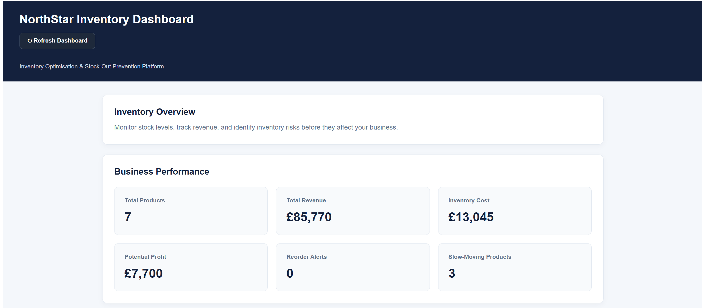
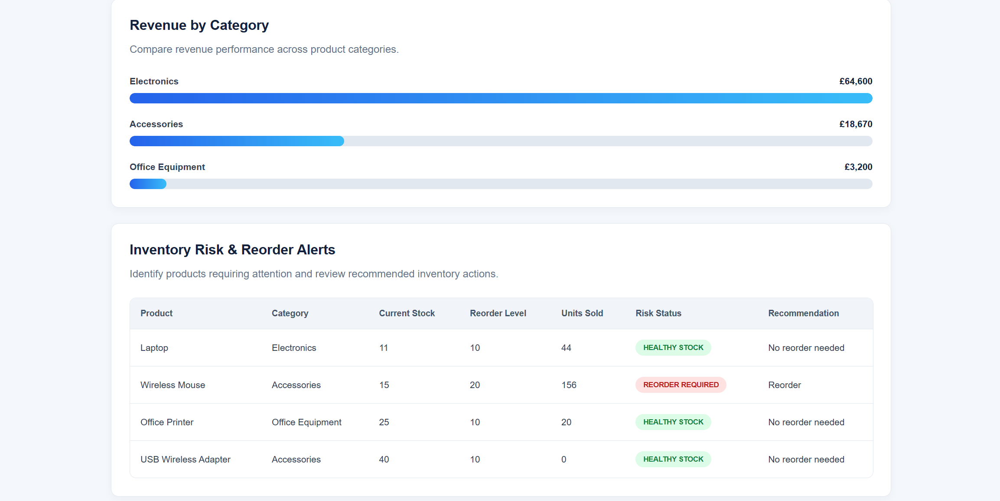
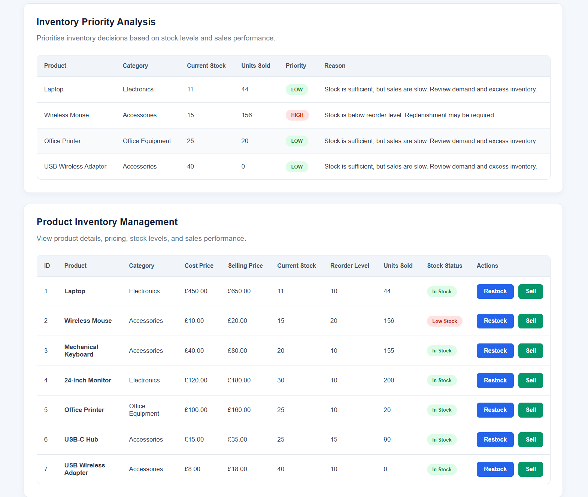
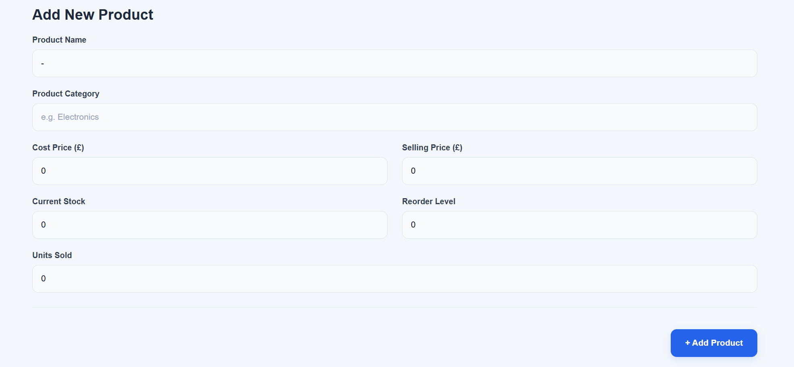

# NorthStar Inventory Optimisation & Stock-Out Prevention Platform

A full-stack inventory management and analytics application designed to help retail businesses monitor stock levels, identify inventory risks, and make better replenishment decisions.

## Business Problem

Retail businesses can lose sales when popular products run out of stock. Excess inventory can also tie up working capital.

NorthStar provides a centralised dashboard for monitoring stock levels, sales performance, and inventory risks.

## Technology Stack

- Backend: Java 17, Spring Boot, Spring Data JPA, REST APIs
- Frontend: Angular 22, TypeScript, HTML, SCSS
- Database: MySQL 8
- Build Tools: Maven, npm
- Version Control: Git, GitHub

## Key Features

- View product inventory and stock levels
- Add products with automatically generated IDs
- Record sales and update stock quantities
- Restock existing products
- Prevent sales when stock is insufficient
- Monitor revenue, inventory cost, and potential profit
- Analyse revenue by product category
- Identify inventory risks and replenishment priorities
- Refresh dashboard data

## Project Status

The Spring Boot backend and Angular dashboard are implemented and integrated. Additional improvements and automated tests are planned.


## Running the Application Locally

### Prerequisites

- Java 17
- Maven
- Node.js and npm
- MySQL 8


### 1. Database Setup

NorthStar uses MySQL 8 to store product and inventory information.

Two SQL scripts are provided in the `database/` directory:

- `schema.sql` — Creates the database and products table if they do not already exist.
- `sample-data.sql` — Adds seven sample products, skipping records with matching IDs or product names.

To set up the database:

1. Open MySQL Workbench and connect using a MySQL account with permission to create databases and tables. Run the setup scripts using that account. The Spring Boot application can then connect using a separate account with permissions on the `northstar_inventory` database.
2. Open `database/schema.sql` and execute it.
3. Open `database/sample-data.sql` and execute it.
4. Confirm that the `northstar_inventory` database contains the `products` table.

The backend connects using the `DB_USERNAME` and `DB_PASSWORD` environment variables.

Use a MySQL account with appropriate permissions for the database. Never commit database passwords or other credentials to GitHub.


### 2. Start the Backend

From the project root, run the following commands in PowerShell:

```powershell
$env:DB_USERNAME = "northstar_app"
$securePassword = Read-Host "Enter MySQL password" -AsSecureString
$env:DB_PASSWORD = [System.Net.NetworkCredential]::new("", $securePassword).Password
mvn spring-boot:run
```

The backend runs at http://localhost:8080.

### 3. Start the Frontend

Open another terminal and run:

```powershell
cd frontend
npm install
npm start
```

Open http://localhost:4200 in your browser.

The Angular development server proxies API requests to the Spring Boot backend.

## REST API Endpoints

### Product Management

| Method | Endpoint | Description |
|---|---|---|
| GET | `/api/products` | Retrieve all products |
| POST | `/api/products` | Create a new product |
| PUT | `/api/products/{productId}` | Update an existing product |
| DELETE | `/api/products/{productId}` | Delete a product |
| PATCH | `/api/products/{productId}/restock` | Increase product stock |
| PATCH | `/api/products/{productId}/sell` | Record a sale and decrease stock |

### Inventory Analytics

| Method | Endpoint | Description |
|---|---|---|
| GET | `/api/analytics` | Retrieve inventory KPIs |
| GET | `/api/analytics/category-revenue` | View revenue by category |
| GET | `/api/analytics/inventory-risks` | Identify inventory risks |
| GET | `/api/analytics/inventory-priorities` | View inventory priorities |

### Business Rules

- Product IDs are automatically generated.
- Selling a product reduces available stock and increases units sold.
- Restocking increases available stock.
- Sales exceeding available stock are rejected with HTTP 409 Conflict.

## Application Screenshots

### 1. Business Performance Dashboard

Overview of key business metrics, including revenue, inventory cost, and potential profit.



### 2. Revenue Analytics and Inventory Risks

Revenue analysis by category, stock-out risks, and reorder alerts.



### 3. Inventory Priorities and Product Management

Inventory priority analysis and product stock management.



### 4. Add New Product

Product creation form with pricing, stock quantities, and reorder settings.




## Testing & Verification

The application has been tested locally to verify its core functionality and database integration.

### Backend Verification
- Successfully executed the Maven test suite using `mvn test`.
- Verified REST API operations for product creation, retrieval and deletion.
- Tested stock replenishment and sales operations through the Angular dashboard.

### Frontend Verification
- Successfully built the Angular application using `npm run build`.
- Verified that the dashboard displays inventory records, business KPIs, category revenue and inventory risk indicators.
- Tested the Add Product, Restock and Sell features.

### Database Verification
- Verified MySQL connectivity and persistent product records.
- Tested the database table structure in a separate test database.
- Successfully inserted seven sample products using the SQL seed script.
- Confirmed that running the sample-data script twice does not create duplicate products.

### Testing Scope
Testing was performed in a local development environment. Automated end-to-end browser tests and production deployment testing have not yet been completed.
